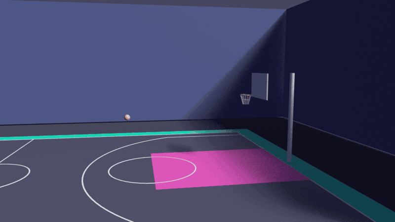

# I Got Next Court Digital Twin

A Python tool that turns a pickup basketball court listing into a 3D scene built with OpenUSD. It generates the court, hoops, and a basketball, animates a jump shot on the simulation timeline, and blocks export until a dry run validation pass succeeds. It runs on any laptop with the open source USD library. The script is written to work inside NVIDIA Omniverse Kit as well, but it has only been tested outside Omniverse so far (previewed in Blender).



*One validated court from the synthetic listings, rendered from the exported USD file in Blender.*

## Why this project exists

I Got Next helps players find pickup courts. Every court is a row of data: size, number of hoops, rim height, surface. A digital twin turns that row into a scene a player could preview before driving across town, and a simulation team could reuse for training or analytics. The risk is bad data. A listing with a 9 meter rim should never become a 3D scene. This tool checks the data first, builds second, and exports last.

## System architecture

Each court goes through the same seven stages. A failure at any stage stops that court and the others keep going.

```
 Listing data (court_spec.json)
        |
 Stage 1: Validate the listing   sizes, hoop count, rim height, shot distance
        |
 Stage 2: Create the USD stage   Z up, meters, 24 ticks per second, 97 ticks
        |
 Stage 3: Build the court        floor, lines, key, backboards, poles, rims
        |
 Stage 4: Reference the ball     separate asset layer, composition reference
        |
 Stage 5: Animate the shot       one time sample per tick
        |
 Stage 6: Dry run validation     references, bounding boxes, collisions, make check
        |
 Stage 7: Export                 court USD file plus manifest.json
```

Key design decisions:

* **Data first.** The listing is validated before any 3D work starts.
* **Layered assets.** The ball lives in its own file and every court references it.
* **Pure function animation.** Ball position depends only on the tick number, so scrubbing and replay always match.
* **Validation gate.** The build happens in a temporary folder and only passing courts reach the output folder.
* **Traceable scenes.** Each scene stores the court_id, name, and city as custom metadata on the root prim.
* **Kit aware.** Inside Omniverse the script syncs the live timeline. Outside Omniverse it skips that step.

## Prerequisites

1. Windows, macOS, or Linux.
2. Python 3.10 or newer. Check with `python3 --version`.
3. Git. Check with `git --version`.
4. Optional for Omniverse: an NVIDIA RTX GPU, a current driver, and Omniverse USD Composer or a Kit based app.

## Installation

```bash
git clone <your repository URL>
cd igotnext_court_twin
python3 -m venv .venv
source .venv/bin/activate            # macOS and Linux
.venv\Scripts\activate               # Windows
python -m pip install -r requirements.txt
python -c "from pxr import Usd; print(Usd.GetVersion())"
```

You should see a version tuple such as `(0, 26, 11)`. A `ModuleNotFoundError` means the environment is not active, so repeat the activate step.

To use Omniverse, open the Script Editor, load `court_twin.py`, and run it. The `pxr` modules ship inside Kit.

## Run it

```bash
python court_twin.py --dryrun                  # validate every court, write nothing
python court_twin.py                           # export every court that passes
python court_twin.py --court gso_indoor_01     # one court only
```

Open any file in `output` with `usdview` or Omniverse USD Composer and press Play.

### View it in Blender (free, no NVIDIA GPU needed)

This project was previewed in Blender 5.2 on a Mac. It has not been run inside Omniverse, so call it Omniverse compatible (standard OpenUSD), not Omniverse tested.

```bash
brew install --cask blender                      # macOS. On Windows, install from blender.org
python court_twin.py                             # create the output folder first
blender --python open_in_blender.py              # gallery: every court in one scene, labeled, all playing
blender --python open_in_blender.py -- output/gso_outdoor_02.usda   # a single court
blender --python open_in_blender.py -- output/a.usda output/b.usda  # chosen courts
```

Gallery mode lays the courts out in a grid of three columns, drops the walls and fences so nothing blocks the view, and puts every court on one dark ground with a label.

Do not use File, Import by hand. Blender skips USD Preview Surface materials by default and ignores material bindings on simple USD shapes, so the court would appear gray. `open_in_blender.py` turns on the right import options and assigns each material by object name. Keep `basketball_asset.usda` beside the court file.

The launcher also sets a sky or arena background and a soft sun, switches the color transform to Standard (the default washes colors out), and hides Blender's black empty markers and grid.

Controls: Spacebar plays and pauses, Home frames the whole court, and the second shading ball at the top right of the 3D view (Material Preview) shows colors and gloss.

### Courts and color themes

`court_spec.json` holds six valid synthetic courts (indoor and outdoor, half and full, three cities) plus one broken listing used to prove the data gate. Each listing can set an optional `"theme"`: `purple` (default for hardwood), `ocean` (default for asphalt), `sunset`, or `neon`. Themes are defined in the `THEMES` table at the top of `court_twin.py`.

Indoor courts get three walls and a dark floor. Outdoor courts get a low clear fence. The front side stays open so a viewer can see in.

### What the scene contains

* Glossy hardwood (or satin asphalt) playing surface on a bright themed out of bounds border.
* Boundary lines, a purple painted key, free throw circles, a three point line with corner lines, and a center circle on full courts.
* Translucent glass backboards, dark metal poles, an orange rim, and a tapered net.
* A basketball with a leather material, referenced from its own asset file.

## Connect it to I Got Next

`court_spec.json` holds synthetic example listings shaped like a court record. To connect real data, export your courts table to the same fields:

* court_id, name, city
* indoor (true or false) and surface (hardwood or asphalt)
* length_m, width_m, hoops, rim_height_m, shot_distance_m

The tool writes `output/manifest.json` with each court_id, its status, any errors, and the USD file name. The app can read that file to show which courts have a preview and which listings need fixing.

## Code walkthrough

* `validate_listing` checks the raw data before any 3D work.
* `create_stage` sets axis, units, timeline range, and the metadata that links the scene to the listing.
* `material` builds a UsdPreviewSurface with color, roughness, metallic, and opacity.
* `build_court` generates floor, lines, painted keys, backboards, poles, rims, and nets.
* `strut`, `ring`, and `net` build the rim and net from thin cylinders so they show up in every viewer.
* `slab`, `circle_marking`, and `three_point_line` draw floor markings.
* `surroundings` adds the ground, walls, or fence, using the colors in `THEMES`.
* `open_in_blender.py` is a separate Blender launcher. It is not part of the export pipeline.
* `author_ball_asset` and `reference_ball` write the ball layer and pull it into the scene.
* `shot_plan` and `ball_position` map a tick to a ball position as a pure function.
* `animate_ball` writes 97 time samples and syncs the Kit timeline when present.
* `validate_scene` runs the reference, bounding box, collision, and make checks.
* `process_court` and `main` orchestrate the run and write the manifest.

## Verification and troubleshooting

An outside engineer can confirm everything works in four steps.

### 1. Run the dry run

```bash
python court_twin.py --dryrun
```

Expected summary:

```
gso_indoor_01      VALIDATED
gso_outdoor_02     VALIDATED
clt_indoor_03      VALIDATED
clt_outdoor_04     VALIDATED
rdu_outdoor_05     VALIDATED
rdu_indoor_06      VALIDATED
bad_example_99     FAILED
```

The last court fails on purpose. Its rim height is 9 meters, and the log says `LISTING ERROR: rim_height_m 9.0 outside 2.4 to 3.1`. This proves the data gate works.

### 2. Read the physics checks

For each good court the log shows:

```
Reference check: PASS
Collision sweep: minimum clearance 0.455 m at tick 60 (required 0.05 m)
Make check: 0.000 m from rim center at tick 60, limit 0.109 m, descending=True
```

The make check confirms the ball is inside the rim and moving downward when it reaches the hoop.

### 3. Inspect the exported scene

```bash
python court_twin.py --court gso_indoor_01
python - <<'PY'
from pxr import Usd, UsdGeom
stage = Usd.Stage.Open("output/gso_indoor_01.usda")
ball = stage.GetPrimAtPath("/World/Ball")
print("Ball composed:", stage.GetPrimAtPath("/World/Ball/Body").IsValid())
print("Time samples:", len(UsdGeom.Xformable(ball).GetTimeSamples()))
print("Linked listing:", stage.GetPrimAtPath("/World").GetCustomDataByKey("igotnext"))
PY
```

Expected: `Ball composed: True`, `Time samples: 97`, and the court details.

### 4. Prove the shot check can fail

```bash
python - <<'PY'
import court_twin as w
w.RIM_RADIUS = 0.1          # rim smaller than the ball
raise SystemExit(w.main(["--dryrun", "--court", "gso_outdoor_02"]))
PY
```

Expected: `VALIDATION ERROR: Shot misses the rim` and a nonzero exit code.

### Common problems

* `ModuleNotFoundError: pxr`. Cause: environment not active. Fix: activate it and reinstall requirements.
* `Unresolved reference`. Cause: the ball file moved. Fix: keep `basketball_asset.usda` beside the court files.
* Court is all gray in Blender. Cause: a manual import skipped the materials. Fix: use `blender --python open_in_blender.py` and switch to Material Preview.
* Court appears without a ball in a viewer. Cause: only one file was copied. Fix: copy the court file and the ball asset together.
* A court shows FAILED. Cause: bad listing data or a layout the ball cannot clear. Fix: read the error lines above the summary and correct the listing.
* Nothing in `output`. Cause: you used `--dryrun`. Fix: run again without that flag.

## Tests

```bash
python -m pip install -r requirements-dev.txt
python -m pytest
```

The suite in `tests/test_court_twin.py` has 66 tests and runs in about a second:

* **Listing validation.** Every limit is checked on the edge and just outside it, so loosening a rule fails a test.
* **Hoop placement and animation.** The ball must start at the release spot, reach the rim center at tick 60, land on the floor at tick 96, arc above both, and only fall after the rim. Calling the animation function in any order gives the same positions.
* **Scene building.** The names the validator searches for (`Backboard`, `Pole`) exist, units are meters, the ball is its own layer.
* **The whole pipeline.** A dry run writes nothing, an export has 97 time samples, a bad listing never builds, and a missed shot or a ball that clips the backboard blocks export.
* **Command line.** Exit codes 0, 1, and 2, and the manifest contents.

`.github/workflows/ci.yml` runs the tests and a dry run on GitHub for every push, on Python 3.10 and 3.12.

## Extend it

* Add players as referenced assets and test player to player clearance.
* Add spectators, bleachers, and a scoreboard as referenced assets.
* Add UsdPhysics rigid bodies so the shot runs under a physics engine in Omniverse.
* Check physics inputs (ball mass, restitution) in the validation gate once the shot is simulated.

## Notes

Student portfolio project. The listing data is synthetic. NVIDIA, Omniverse, and OpenUSD belong to their respective owners.
